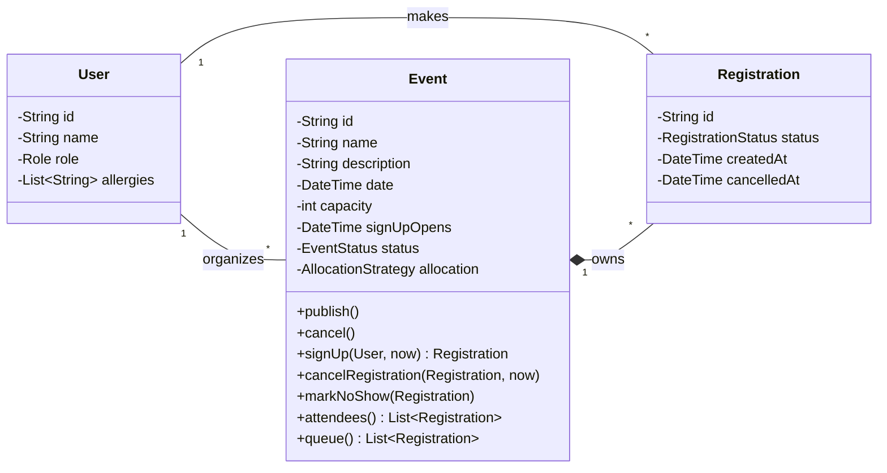
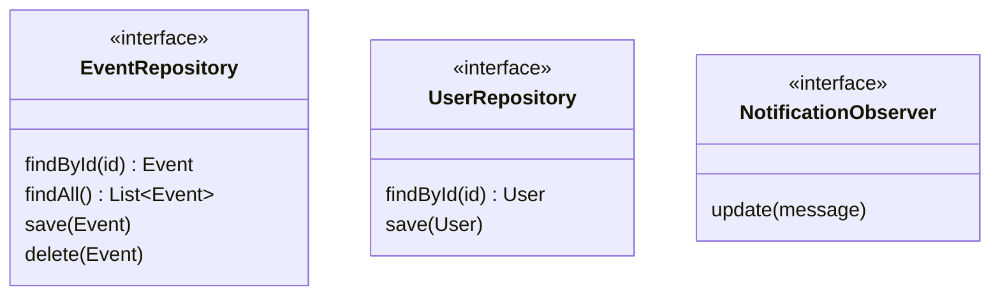
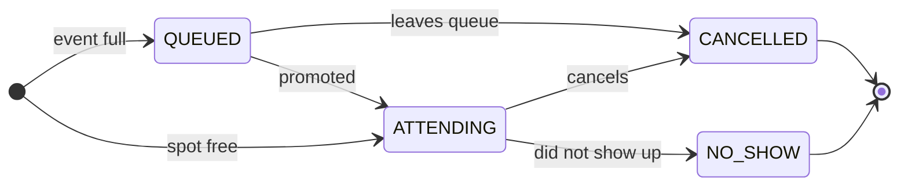
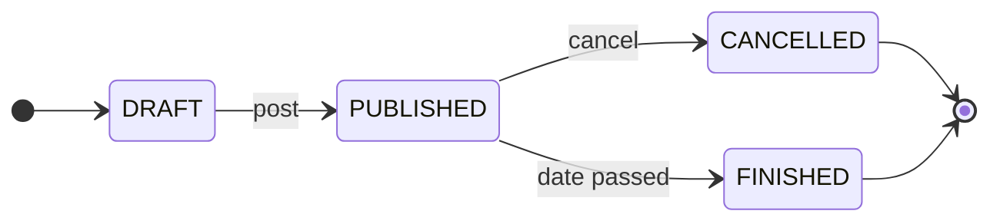
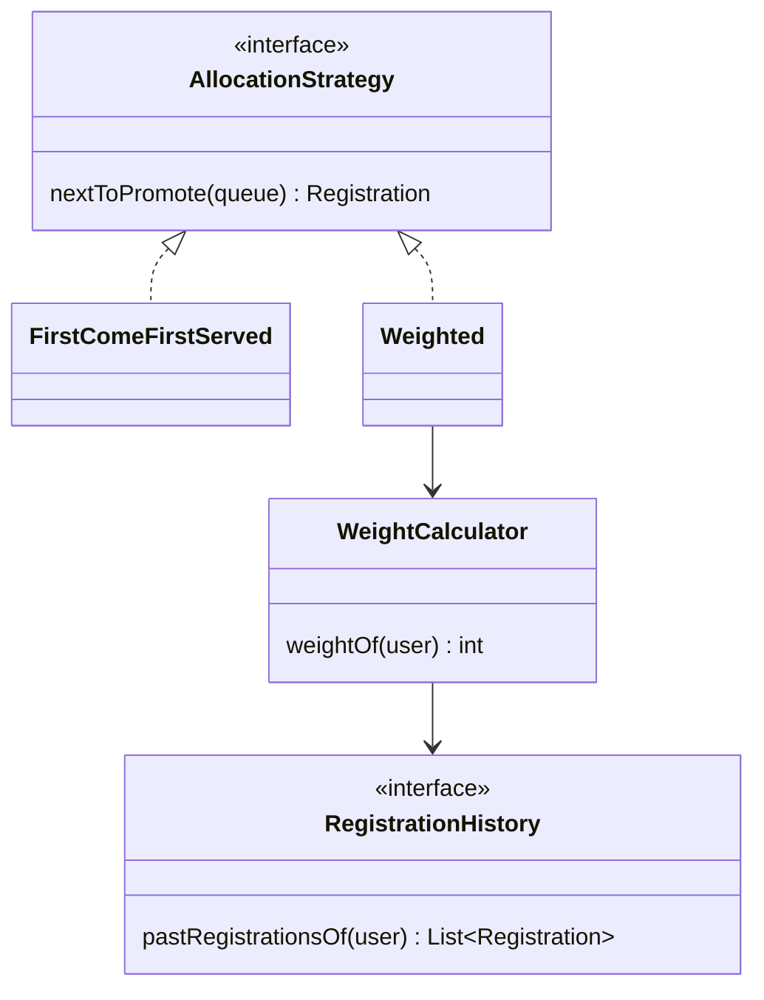
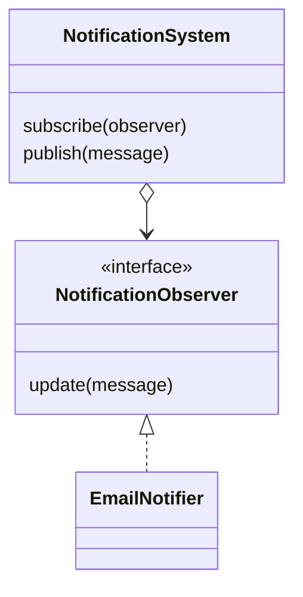

# Architecture

## Overview

Monorepo with two separately built apps:

```
server/   REST backend (Java 17, Maven)
web/      SvelteKit frontend (TypeScript, pnpm)
```

The web app talks to the server over HTTP. The server owns all domain logic and persistence.

## Stack

### Server (`server/`)

- Java 17, package `it.chalmers.commit`, built with Maven into one runnable jar (`java -jar target/server.jar`)
- No application framework. HTTP is the JDK's own `com.sun.net.httpserver.HttpServer`, with a small `Router` on top
- Gson for JSON
- Hibernate ORM (without Spring) with PostgreSQL, and Flyway for schema migrations in `src/main/resources/db/migration`. Hibernate only validates the schema, it never changes it
- Settings come from environment variables: `DB_URL`, `DB_USER`, `DB_PASSWORD` (default to a local `oop` database), `PORT` (default 8080) and `WEB_ORIGIN` (the web app's origin for CORS, default `http://localhost:5173`)
- All routes live under `/api`, and errors are JSON like `{"error": "message"}`

#### Packages

- `model`: the domain objects and all database access. A `Database` class owns the Hibernate `SessionFactory`, and collection-style classes (for example an `Events` class) use it, so nothing outside the model sees a Hibernate session. The model may use any library but must not depend on `view` or `controller`
- `view`: the JSON representations of the model, so model objects are never sent directly
- `controller`: the HTTP handlers. They parse the request, call the model and answer with a view. The generic HTTP machinery (`Server`, `Router`, `Request`, `Response`, `Json`) is in `controller/http`, and each resource gets its own controller next to it

Dependencies run `controller -> view -> model`. These rules are checked by `ArchitectureTests`.

### Web (`web/`)

- SvelteKit 3 with Svelte 5, built with Vite and served by `adapter-node` (`pnpm build`, then `pnpm start`)
- Tailwind CSS v4 for styling
- shadcn-svelte (style `nova`, neutral base, lucide icons) for UI components, primary color `#09CDDA`
- Import aliases: `#lib` -> `src/lib`, components in `#lib/components`, UI primitives in `#lib/components/ui`
- Geist as the font

## Web-server communication

> Decided, not implemented yet.

Both apps are served on a single domain. The reverse proxy routes by path:

- `/api/**` goes to the server.
- Everything else goes to the SvelteKit web app.

Consequences:

- The server exposes its JSON REST API under `/api`. The web app is the only client.
- The browser calls `/api` directly. It is the same origin, so no CORS setup is needed and the session cookie is sent automatically.
- `/api` is reserved for the server. SvelteKit must not define routes under it, because the proxy would intercept them.
- The server is publicly reachable, but only under `/api`. Every endpoint there requires login unless noted (login is not built yet).
- SvelteKit `load` functions may also call the server, over the private network and forwarding the user's cookie.
- The limit to `/api` is enforced by the routing in Dokploy: only `/api` is forwarded to the server, so nothing else on it is reachable from outside.

## Authentication (Gamma)

> Decided: the server implements the login flow itself, without Spring Security (see below). Not implemented yet. Gamma's user fields and group data are still to be verified.

Login uses Gamma (the IT section's account system) over OAuth 2.0 authorization code flow.

1. The user clicks "Log in" on the web app and is redirected to Gamma.
2. Gamma redirects back with an authorization code.
3. The code is exchanged for tokens and the user is identified (stable id, name, and membership info if Gamma provides it).
4. The user is stored or updated on our side and gets a session.
5. Later requests from the web app to the server carry that session.

- Decided: the server acts as the OAuth client and owns the whole login flow, using the JDK's `java.net.http.HttpClient` and server-side sessions kept in a cookie. The web app forwards the session cookie to the server.
- Roles (e.g. organizer vs. student) are decided on the server, never trusted from the web app.
- Local development needs either a Gamma dev client or a fake login, so the app can run without access to Gamma.

## Local development and deployment

Requirements: Java 17, Node 24 (see `web/.nvmrc`), pnpm, PostgreSQL.

| Part | Command | Default address |
| --- | --- | --- |
| Database | PostgreSQL with a database named `oop` | `localhost:5432` |
| Server | `cd server && ./mvnw package && java -jar target/server.jar` | `localhost:8080` |
| Web | `cd web && pnpm install && pnpm dev` | `localhost:5173` |

- Server DB settings: `DB_URL`, `DB_USER`, `DB_PASSWORD`. The defaults match a local Postgres with user and password `postgres`.
- `./mvnw test` runs the tests. They need no database for now.
- Production web build: `cd web && pnpm build && pnpm start` (runs `node build`).
- Production server build: `cd server && ./mvnw package`, then run the jar with the DB variables set.
- Hosted on a Dokploy instance.
- CI (GitHub Actions) runs on every PR. Server: `./mvnw verify` (compile, tests including the architecture rules, Spotless formatting). Web: Prettier check, `svelte-check` and build.

## Requirements

User stories live in the GitHub issues. This is the short list they roll up to.

### Required

- Create, read, update and delete events (event CRUD)
- Post events (publish them so users can see them)
- Sign up for an event
- Queueing system: when an event is full, sign-ups join a queue and are promoted when a spot frees up
- Saved information for end users (e.g. allergies), reused when signing up
- Login with Gamma
- Notifications and reminders

### Nice to have

- Filter and sort events
- Ticket verification
- Contacting the organizer
- Social credit system
- Stop abuse (limit sign-ups and posting)

## MVC and package structure

> Proposed. The MVC mapping needs to be confirmed with the supervisor.

The course requires a model-heavy MVC architecture where the model is entirely independent of the view and the controllers. We follow the same split as the course's Maven template: a `model` package that knows nothing about the rest.

| MVC part | Where it lives | Language |
| --- | --- | --- |
| Model | `server`, package `model` | Java |
| Controller | `server`, package `controller` (HTTP handlers) | Java |
| View | `web` (SvelteKit) renders the UI. `server`, package `view`, holds the JSON shapes the API returns | TypeScript / Svelte, Java |

```
server/src/main/java/it/chalmers/commit/
├── model/          Domain classes and rules, and all database access (Database, Hibernate entities).
├── view/           JSON shapes of what the API returns.
└── controller/     HTTP handlers. Translate HTTP to calls on the model.
    └── http/       The HTTP machinery: Server, Router, Request, Response, Json.
server/src/test/java/it/chalmers/commit/
└── ArchitectureTests.java
```

Rules:

- **The model may use any library, but never `view` or `controller`.** Hibernate annotations such as `@Entity` are fine in `model`.
- **Dependencies point inwards.** `controller` depends on `view` and `model`, `view` depends on `model`. `model` depends on neither. `ArchitectureTests` enforces this.
- **The model owns the rules.** Signing up, queueing, promotion, cancelling and status changes are methods on model classes, not logic in controllers or services.
- **Controllers stay thin.** A controller loads model objects through a collection class in `model` (for example `Events`), calls one model method, and returns a `view`.
- **All database access lives in `model`.** A `Database` class owns the Hibernate `SessionFactory`. Controllers and views never import Hibernate, JDBC or Flyway, which `ArchitectureTests` also checks.
- **The model's entities are the database tables.** The model classes carry the Hibernate annotations directly, and there is no separate persistence layer or mapper.

## Domain model

> Draft. Names and fields will change as the code is written.

Everything in this section lives in the `model` package.



Enums: `Role` (STUDENT, ORGANIZER), `EventStatus` (DRAFT, PUBLISHED, CANCELLED, FINISHED), `RegistrationStatus` (ATTENDING, QUEUED, CANCELLED, NO_SHOW).

- **Event owns its registrations.** An event holds its `Registration` objects and is the only thing that creates or changes them. Other code asks the event, e.g. `event.signUp(user, now)`.
- **Registration** is one user's sign-up for one event. The attendee list and the queue are both registrations, told apart by `status`.
- **Signing up:** `signUp` checks that the event is published and sign-up has opened, then creates a registration that is `ATTENDING` if there is a free spot and `QUEUED` otherwise.
- **Queue promotion:** when an attending registration is cancelled, or the capacity is raised, the event asks its `AllocationStrategy` who is next and makes that registration `ATTENDING`.
- **Illegal changes are rejected by the model itself**, for example signing up twice or cancelling a registration that is already cancelled.
- **Time is passed in.** Methods that depend on the current time take it as a parameter, so the model never reads the system clock and tests can choose the time.

Interfaces the model defines and other packages implement:



### State machines

Both `Event.status` and `Registration.status` follow fixed transitions. Any other change is rejected by the model.

**Registration**



When an attending registration is cancelled, the next one in the queue is promoted. `NO_SHOW` is set by the organizer after the event.

**Event**



Editing a published event does not change its status. Only a draft can be deleted. A published event is cancelled instead, and `DELETE /events/{id}` on a non-draft event is rejected.

- Sign-up is only possible while the event is `PUBLISHED` and the current time is after `signUpOpens`. "Open" is not a status of its own, it is derived from the time.
- Cancelling an event cancels all its registrations and notifies the users.
- TODO(team): should a finished or cancelled event stay visible, or be archived?

### Allocation (Strategy)

How spots are given out is behind an interface, so the rule can change without touching the rest. The organizer picks one per event, and the event holds it as an `AllocationStrategy` object. First come, first served is the default.



- **FirstComeFirstServed:** promotes the `QUEUED` registration with the earliest `createdAt`.
- **Weighted (optional):** a weighted queue. People still join in sign-up order, but each user's weight bumps them down the queue, so reliable users move ahead of unreliable ones who signed up earlier. The next person promoted is the one at the top of the weighted queue.

**Weight.** It works like a grid penalty in motorsport: a user's weight is a number of places they drop from where they would otherwise start, based on past behaviour. The `WeightCalculator` computes it from the user's past registrations across all events, which it gets through the model-defined `RegistrationHistory` interface (implemented in `model`, see [Persistence and schema](#persistence-and-schema)):

```
weight = min(maxWeight, noShowWeight * noShows + lateCancelWeight * lateCancels)
```

A registration's position in the queue is then:

```
score = arrivalIndex + weight(user)
```

The queue is sorted by `score` (lowest first). Ties go to the earliest `createdAt`.

Example: Alice signed up 1st but has 1 no-show (weight 3), Bob signed up 3rd with a clean record. Alice's score is 1 + 3 = 4 and Bob's is 3 + 0 = 3, so Bob is promoted first.

- A no-show is a registration with status `NO_SHOW`.
- A late cancellation is a `CANCELLED` registration where `cancelledAt` is less than a cutoff before the event date.
- Only recent history counts (e.g. the last 12 months), so users can recover.
- `maxWeight` caps the penalty so nobody is pushed down forever.
- Weight is never stored. It is calculated from the user's past registrations, so it cannot get out of sync. The score is recalculated whenever the queue changes.
- TODO(team): choose the numbers (`noShowWeight`, `lateCancelWeight`, `maxWeight`, cutoff for "late", history window). Decide whether they are global settings or set per event.

### Notifications (Observer)

The model publishes a message when something happens (sign-up confirmed, promoted from the queue, event changed). Notifiers listen and deliver them. `NotificationSystem` and the `NotificationObserver` interface live in `model`. `EmailNotifier` lives in the `notification` package, so the model never knows how a message is sent.



- Reminders (e.g. "30 minutes before sign-up opens") are time-based. A scheduler outside the model checks what is due and calls the notification system, so the model stays testable without real time passing.
- TODO(team): decide who gets a reminder, everyone or only users who opted in.

## Persistence and schema

> Proposed. Nothing here is implemented yet.

There is one thing to keep in sync: the database schema with the entity classes in `model`.

### Database schema and JPA entities

- **Flyway migrations are the source of truth for the schema.** SQL files in `server/src/main/resources/db/migration/`, one per schema change.
- **Naming: `NNN__description.sql`**, for example `001__create_tables.sql` and `002__add_event_location.sql`. Numbers are zero-padded and count up. Never edit a migration that has been merged, add a new one instead.
- **Drafting a migration:** change the entity, start the local database, then run `cd server && ./new-migration add_event_location`. It applies the existing migrations to the local database, asks Hibernate what SQL is missing to match the entities, and saves that as the next numbered file. Read the file before committing it: Hibernate treats a renamed column as a drop plus an add. Run it against your own local database, not the shared one.
- **Hibernate only validates.** Set `hibernate.hbm2ddl.auto=validate`. The server then refuses to start if an entity and the schema disagree, instead of drifting silently.
- **`update` is not safe.** It never drops or renames columns, so each teammate's local database and the Dokploy database slowly diverge from the entities. It is only acceptable during the first days, before the entities settle.
- **Entity change and migration go in the same PR.** A change to a JPA entity without a migration is incomplete.

### Model classes and entities

- **The model classes are the entities.** `Event`, `User` and the rest carry the Hibernate annotations directly. Entities need a `protected` no-argument constructor and non-final fields, but still have no public setters.
- **Aggregate = `Event` with its `Registration`s.** The aggregate is loaded and saved as a whole, so `Event` can enforce its rules over all its registrations.
- **Collection-style classes in `model`** (for example `Events`) load and save through `Database.inTransaction`. Nothing outside `model` sees a Hibernate session.
- **Cross-event history lives in `model` too.** The `WeightCalculator` in the weighted queue needs a user's past registrations across all events, which is not part of any `Event` aggregate. A separate model class (for example `RegistrationHistory`) queries it.
- **Rejected: a separate persistence layer with hand-written entities and mappers.** It keeps the model free of annotations, but doubles the classes. We chose less code over a model with no framework imports.

## API

> Draft. Paths, methods and rules are a starting point for the team to agree on. All endpoints are under `/api` and require login unless noted.

| Method | Path | Purpose | Who |
| --- | --- | --- | --- |
| GET | `/events` | List events (later: filter and sort) | Any user |
| POST | `/events` | Create an event | Organizer |
| GET | `/events/{id}` | Event details | Any user |
| PUT | `/events/{id}` | Update an event | Event's organizer |
| DELETE | `/events/{id}` | Delete a draft event (others are cancelled) | Event's organizer |
| POST | `/events/{id}/signups` | Sign up for an event. Joins the queue if the event is full | Any user |
| DELETE | `/events/{id}/signups/me` | Cancel own sign-up. Next in queue is promoted | Signed-up user |
| GET | `/events/{id}/signups` | See attendees and queue | Event's organizer |
| GET | `/me` | Current user and saved information (e.g. allergies) | Any user |
| PUT | `/me` | Update saved information | Any user |
| GET | `/me/signups` | The user's sign-ups and queue positions | Any user |

Notifications and reminders are sent by the server and have no endpoints for now. TODO(team): add endpoints if users get to choose notification settings.
