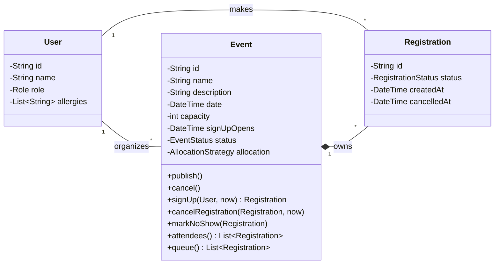
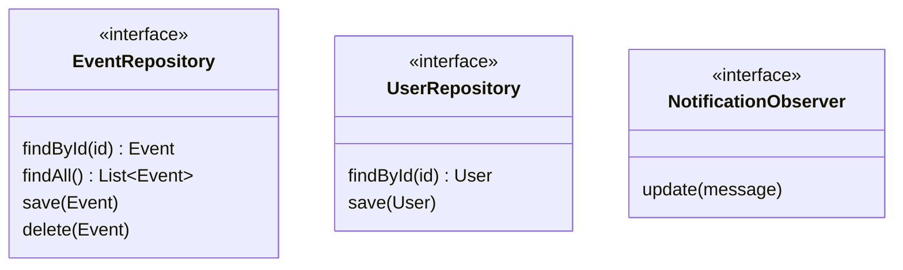
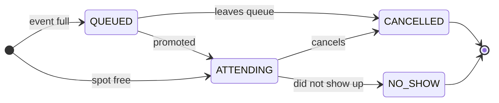
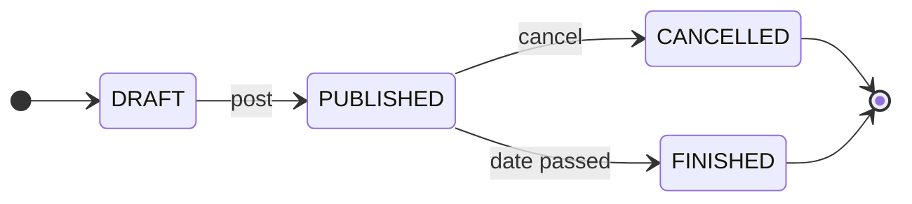
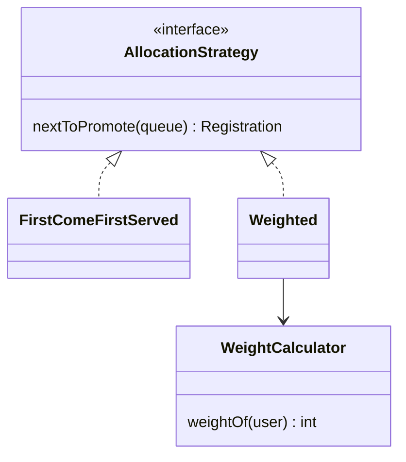
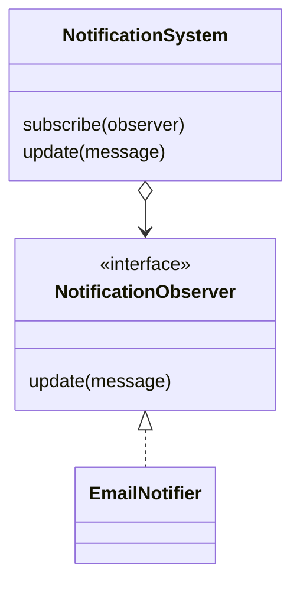

# Architecture

## Overview

Monorepo with two separately built apps:

```
server/   Spring Boot REST backend (Java 17, Maven)
web/      SvelteKit frontend (TypeScript, pnpm)
```

The web app talks to the server over HTTP. The server owns all domain logic and persistence.

## Stack

### Server (`server/`)

- Spring Boot 4.1 (Java 17), package `it.chalmers.commit`
- Spring Web MVC for the HTTP layer, Spring Security for auth, Bean Validation for input checks
- Spring Data JPA with PostgreSQL (H2 for tests)
- Actuator for health/metrics
- Database connection is configured via `DB_URL`, `DB_USER`, `DB_PASSWORD` (defaults to a local `oop` database)

### Web (`web/`)

- SvelteKit 3 with Svelte 5, built with Vite and served by `adapter-node` (`pnpm build`, then `pnpm start`)
- Tailwind CSS v4 for styling
- shadcn-svelte (style `nova`, neutral base, lucide icons) for UI components, primary color `#09CDDA`
- Import aliases: `#lib` -> `src/lib`, components in `#lib/components`, UI primitives in `#lib/components/ui`
- Geist as the font

## Web-server communication

> Decided, not implemented yet.

Both apps are served on a single domain. The reverse proxy routes by path:

- `/api/**` goes to the Spring server.
- Everything else goes to the SvelteKit web app.

Consequences:

- The server exposes its JSON REST API under `/api`. The web app is the only client.
- The browser calls `/api` directly. It is the same origin, so no CORS setup is needed and the session cookie is sent automatically.
- `/api` is reserved for the server. SvelteKit must not define routes under it, because the proxy would intercept them.
- The server is publicly reachable, but only under `/api`. Spring Security guards every endpoint there.
- SvelteKit `load` functions may also call the server, over the private network and forwarding the user's cookie.
- The limit to `/api` is enforced by the routing in Dokploy: only `/api` is forwarded to the server, so nothing else on it is reachable from outside.

## Authentication (Gamma)

> Proposed, not implemented yet. Gamma's user fields and group data are still to be verified.

Login uses Gamma (the IT section's account system) over OAuth 2.0 authorization code flow.

1. The user clicks "Log in" on the web app and is redirected to Gamma.
2. Gamma redirects back with an authorization code.
3. The code is exchanged for tokens and the user is identified (stable id, name, and membership info if Gamma provides it).
4. The user is stored or updated on our side and gets a session.
5. Later requests from the web app to the server carry that session.

- Decided: Spring Security acts as the OAuth client and owns the whole login flow. The web app forwards the session cookie to the server.
- Roles (e.g. organizer vs. student) are decided on the server, never trusted from the web app.
- Local development needs either a Gamma dev client or a fake login, so the app can run without access to Gamma.

## Local development and deployment

Requirements: Java 17, Node 24 (see `web/.nvmrc`), pnpm, PostgreSQL.

| Part | Command | Default address |
| --- | --- | --- |
| Database | PostgreSQL with a database named `oop` | `localhost:5432` |
| Server | `cd server && ./mvnw spring-boot:run` | `localhost:8080` |
| Web | `cd web && pnpm install && pnpm dev` | `localhost:5173` |

- Server DB settings: `DB_URL`, `DB_USER`, `DB_PASSWORD`. The defaults match a local Postgres with user and password `postgres`.
- Tests use the in-memory H2 database (`./mvnw test`).
- Production web build: `cd web && pnpm build && pnpm start` (runs `node build`).
- Production server build: `cd server && ./mvnw package`, then run the jar with the DB variables set.
- Hosted on a Dokploy instance.
- TODO(team): decide whether to add CI.

## Requirements

User stories live in the GitHub issues. This is the short list they roll up to.

### Required

- Create, read, update and delete events (event CRUD)
- Post events (publish them so users can see them)
- Sign up for an event
- Queueing system: when an event is full, sign-ups join a queue and are promoted when a spot frees up
- Saved information for end users (e.g. allergies), reused when signing up
- Login with Gamma
- Notifications and reminders

### Nice to have

- Filter and sort events
- Ticket verification
- Contacting the organizer
- Social credit system
- Stop abuse (limit sign-ups and posting)

## MVC and package structure

> Proposed. The MVC mapping needs to be confirmed with the supervisor.

The course requires a model-heavy MVC architecture where the model is entirely independent of the view and the controllers. We follow the same split as the course's Maven template: a `model` package that knows nothing about the rest.

| MVC part | Where it lives | Language |
| --- | --- | --- |
| Model | `server`, package `model` | Plain Java |
| Controller | `server`, package `controller` (Spring REST controllers) | Java |
| View | `web` (SvelteKit) | TypeScript / Svelte |

```
server/src/main/java/it/chalmers/commit/
├── model/          Domain classes and rules. Plain Java only.
├── controller/     REST endpoints. Translate HTTP to calls on the model.
├── persistence/    JPA entities and repository implementations.
├── notification/   Notifiers such as EmailNotifier.
└── auth/           Gamma login.
server/src/test/java/it/chalmers/commit/
└── model/          Unit tests for the model, run without Spring or a database.
```

Rules:

- **The model imports nothing from Spring, JPA or any other framework.** No annotations such as `@Entity` or `@Service` in `model`. It can be compiled and tested alone.
- **Dependencies point inwards.** `controller`, `persistence`, `notification` and `auth` depend on `model`. `model` depends on none of them.
- **The model owns the rules.** Signing up, queueing, promotion, cancelling and status changes are methods on model classes, not logic in controllers or services.
- **Controllers stay thin.** A controller loads model objects through a repository, calls one model method, saves the result and returns it.
- **The model defines interfaces for what it needs from outside** (repositories, notifications, the current time). The other packages implement them. This is dependency inversion.
- **The database is a detail.** `persistence` has its own JPA classes and maps them to and from model objects. The model classes are not database tables.

## Domain model

> Draft. Names and fields will change as the code is written.

Everything in this section lives in the `model` package.



Enums: `Role` (STUDENT, ORGANIZER), `EventStatus` (DRAFT, PUBLISHED, CANCELLED, FINISHED), `RegistrationStatus` (ATTENDING, QUEUED, CANCELLED, NO_SHOW).

- **Event owns its registrations.** An event holds its `Registration` objects and is the only thing that creates or changes them. Other code asks the event, e.g. `event.signUp(user, now)`.
- **Registration** is one user's sign-up for one event. The attendee list and the queue are both registrations, told apart by `status`.
- **Signing up:** `signUp` checks that the event is published and sign-up has opened, then creates a registration that is `ATTENDING` if there is a free spot and `QUEUED` otherwise.
- **Queue promotion:** when an attending registration is cancelled, or the capacity is raised, the event asks its `AllocationStrategy` who is next and makes that registration `ATTENDING`.
- **Illegal changes are rejected by the model itself**, for example signing up twice or cancelling a registration that is already cancelled.
- **Time is passed in.** Methods that depend on the current time take it as a parameter, so the model never reads the system clock and tests can choose the time.

Interfaces the model defines and other packages implement:



### State machines

Both `Event.status` and `Registration.status` follow fixed transitions. Any other change is rejected by the model.

**Registration**



When an attending registration is cancelled, the next one in the queue is promoted. `NO_SHOW` is set by the organizer after the event.

**Event**



Editing a published event does not change its status. A draft can be deleted.

- Sign-up is only possible while the event is `PUBLISHED` and the current time is after `signUpOpens`. "Open" is not a status of its own, it is derived from the time.
- Cancelling an event cancels all its registrations and notifies the users.
- TODO(team): should a finished or cancelled event stay visible, or be archived?

### Allocation (Strategy)

How spots are given out is behind an interface, so the rule can change without touching the rest. The organizer picks one per event, and the event holds it as an `AllocationStrategy` object. First come, first served is the default.



- **FirstComeFirstServed:** promotes the `QUEUED` registration with the earliest `createdAt`.
- **Weighted (optional):** a weighted queue. People still join in sign-up order, but each user's weight bumps them down the queue, so reliable users move ahead of unreliable ones who signed up earlier. The next person promoted is the one at the top of the weighted queue.

**Weight.** It works like a grid penalty in motorsport: a user's weight is a number of places they drop from where they would otherwise start, based on past behaviour. The `WeightCalculator` computes it:

```
weight = min(maxWeight, noShowWeight * noShows + lateCancelWeight * lateCancels)
```

A registration's position in the queue is then:

```
score = arrivalIndex + weight(user)
```

The queue is sorted by `score` (lowest first). Ties go to the earliest `createdAt`.

Example: Alice signed up 1st but has 1 no-show (weight 3), Bob signed up 3rd with a clean record. Alice's score is 1 + 3 = 4 and Bob's is 3 + 0 = 3, so Bob is promoted first.

- A no-show is a registration with status `NO_SHOW`.
- A late cancellation is a `CANCELLED` registration where `cancelledAt` is less than a cutoff before the event date.
- Only recent history counts (e.g. the last 12 months), so users can recover.
- `maxWeight` caps the penalty so nobody is pushed down forever.
- Weight is never stored. It is calculated from the user's past registrations, so it cannot get out of sync. The score is recalculated whenever the queue changes.
- TODO(team): choose the numbers (`noShowWeight`, `lateCancelWeight`, `maxWeight`, cutoff for "late", history window). Decide whether they are global settings or set per event.

### Notifications (Observer)

The model publishes a message when something happens (sign-up confirmed, promoted from the queue, event changed). Notifiers listen and deliver them. `NotificationSystem` and the `NotificationObserver` interface live in `model`. `EmailNotifier` lives in the `notification` package, so the model never knows how a message is sent.



- Reminders (e.g. "30 minutes before sign-up opens") are time-based. A scheduler outside the model checks what is due and calls the notification system, so the model stays testable without real time passing.
- TODO(team): decide who gets a reminder, everyone or only users who opted in.

## API

> Draft. Paths, methods and rules are a starting point for the team to agree on. All endpoints are under `/api` and require login unless noted.

| Method | Path | Purpose | Who |
| --- | --- | --- | --- |
| GET | `/events` | List events (later: filter and sort) | Any user |
| POST | `/events` | Create an event | Organizer |
| GET | `/events/{id}` | Event details | Any user |
| PUT | `/events/{id}` | Update an event | Event's organizer |
| DELETE | `/events/{id}` | Delete an event | Event's organizer |
| POST | `/events/{id}/signups` | Sign up for an event. Joins the queue if the event is full | Any user |
| DELETE | `/events/{id}/signups/me` | Cancel own sign-up. Next in queue is promoted | Signed-up user |
| GET | `/events/{id}/signups` | See attendees and queue | Event's organizer |
| GET | `/me` | Current user and saved information (e.g. allergies) | Any user |
| PUT | `/me` | Update saved information | Any user |
| GET | `/me/signups` | The user's sign-ups and queue positions | Any user |

Notifications and reminders are sent by the server and have no endpoints for now. TODO(team): add endpoints if users get to choose notification settings.
